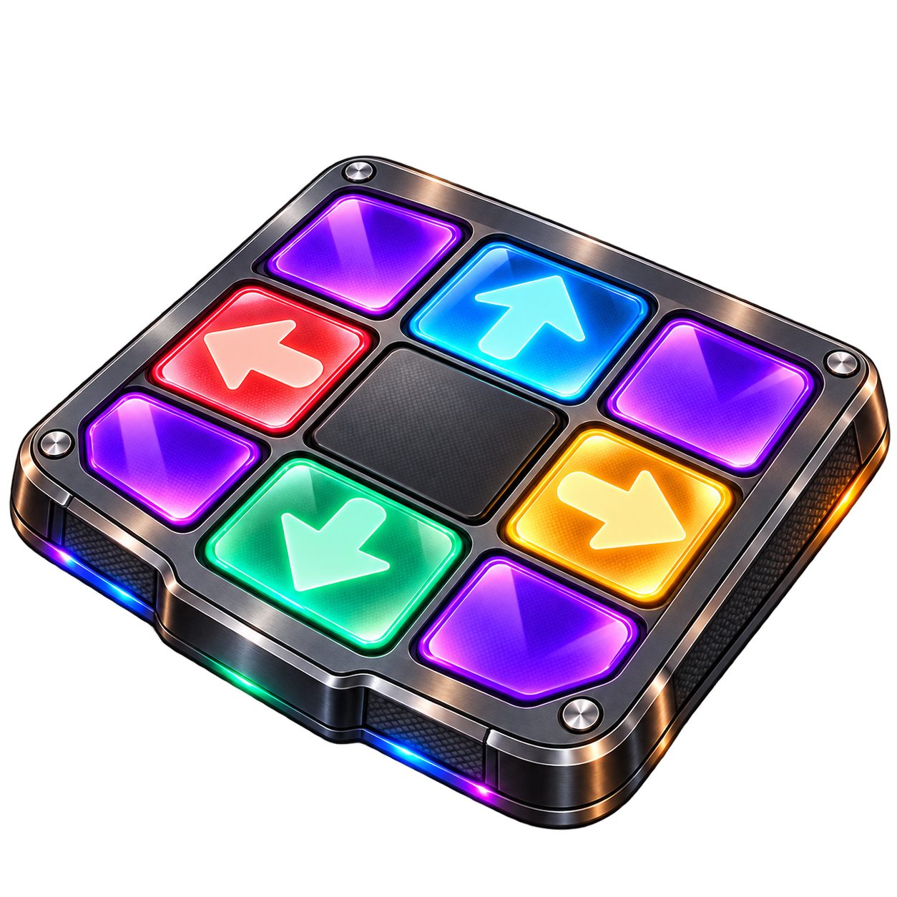
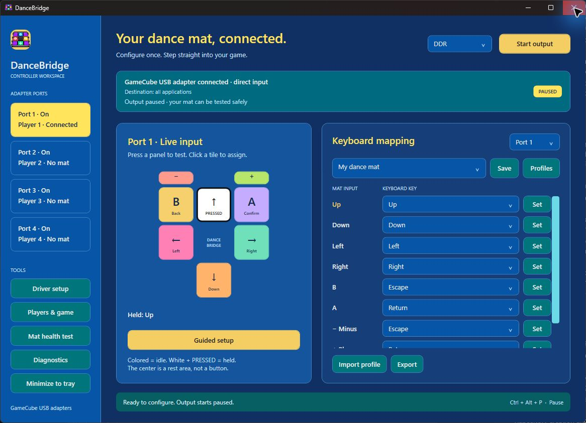
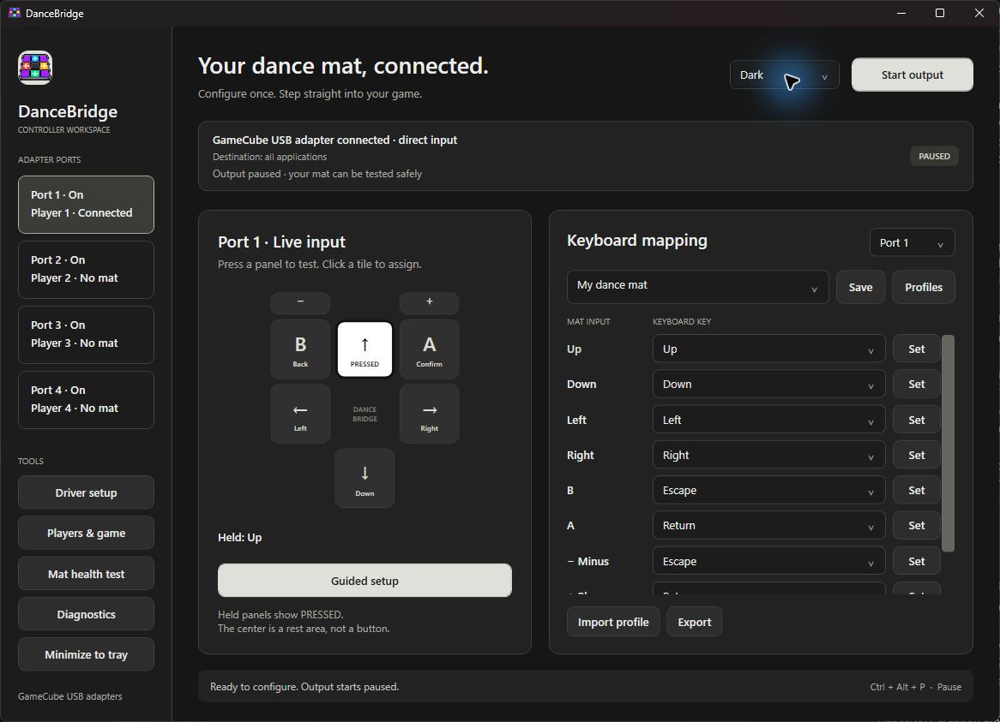
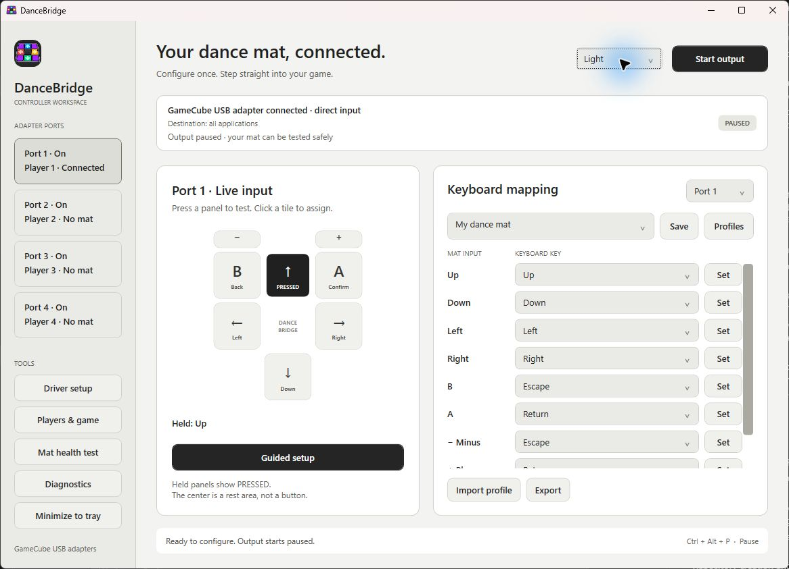
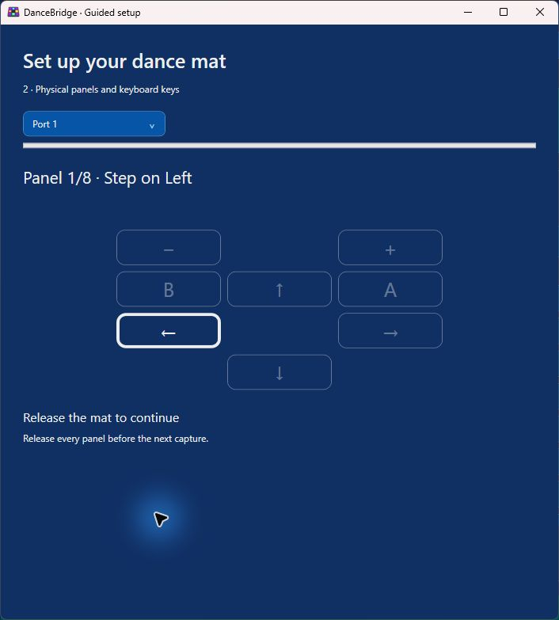
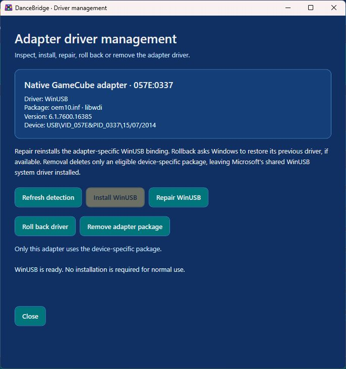

<p align="center"></p>
<h1 align="center">DanceBridge</h1>
<p align="center">Your Wii dance mat. Your PC. One app.</p>

DanceBridge connects a Konami Wii DDR dance mat through a compatible GameCube USB adapter and turns its panels into keyboard input. It includes guided calibration, live testing and driver management in one native Windows application.

[Download the Windows preview](https://github.com/ThuGie/DanceBridge/releases/tag/v0.1.0-preview) · [Hardware compatibility](docs/COMPATIBILITY.md) · [Report an issue](https://github.com/ThuGie/DanceBridge/issues)



## Get started

1. Download and extract **DanceBridge-windows-x64.zip**, then run **DanceBridge.exe**. The .NET runtime is included.
2. Connect the adapter's data USB cable and your mat. Select Wii U/Switch mode if your adapter has a mode switch.
3. Close other applications using the adapter, such as Dolphin or Delfinovin.
4. Open **Driver setup** if the adapter needs WinUSB. Everything required is bundled; no Zadig or separate driver utility is needed. Windows asks for administrator approval when changing a driver.
5. Follow **Guided setup**. Step on each highlighted physical panel and press the keyboard key you want. Escape and Return can be assigned to − and +.
6. Complete the automatic press/release, opposite-arrow, rapid-tap and hold checks. Choose **Save setup** when the guide detects completion.
7. Configure the same keyboard bindings in your game, then choose **Start output**.

**Ctrl+Alt+P pauses output globally.** You can also pause from the tray menu. Output starts paused each time you launch the app.

## Built for dance mats

- **Correct Wii layout:** B–Up–A, Left/Right, Down, and a separate −/+ strip. Physical signal calibration is independent of keyboard mappings.
- **Interactive setup:** highlighted targets, live input feedback, tap counters, hold progress and automatic completion. Unfinished calibration resumes after restarting; health checks require fresh input.
- **Profile library:** create, duplicate, rename, restore defaults, import and export profiles.
- **Four independent ports:** player names, enable switches, keyboard presets and warnings for shared directional keys.
- **Game focus:** optionally select a game executable so output is sent only while that game is foreground. Release all panels before output resumes.
- **Automatic saving:** mappings, player settings and game selection persist. The theme, selected profile, port and window size are remembered.
- **Three themes:** neutral Dark, Light and a colorful DDR theme. Held inputs have a distinct high-contrast state and a text readout.
- **Driver management:** inspect, install, repair, roll back and remove the adapter's driver, with target details and package safeguards.

### Appearance





### Guided setup



The guide separates physical panels from raw GameCube signals. A panel is confirmed by actual input, not by clicking Next. Missing optional panels are explicitly recorded as unavailable; they are not reported as passing a test.

### Driver management



Driver changes run through a bundled elevated helper. DanceBridge records the previous binding and operation results under `%ProgramData%\DanceBridge`. Rollback depends on Windows having a previous driver available. Removal is allowed only for a device-specific OEM package that is not shared by another registered device; Microsoft's shared WinUSB driver is never deleted. Restart Windows if the operation reports that a reboot is required.

## Compatibility and preview status

**Windows 10/11 x64.** The implemented adapter backend supports the native `057E:0337` protocol family: Nintendo Wii U/Switch adapters and compatible devices in Wii U/NS mode. WUP-028 identifies a protocol family, not a guaranteed brand.

The connected WUP-028 and Konami Wii mat were used to validate live input and guided setup. Automated checks cover report parsing, simultaneous directions, shared key ownership, calibration, profile persistence, health checks and driver package guards. USB reports were measured at approximately 125 Hz; this is not an end-to-end latency measurement.

Other adapter models, four-mat gameplay and individual games need further hardware testing. Generic USB mats, Raphnet HID adapters and adapter PC/HID mode need a separate backend and are not supported yet. See the [compatibility table and sources](docs/COMPATIBILITY.md).

This first public release is an **unsigned preview**. Fresh driver installation, repair, rollback and removal have not all been exercised on clean machines. Read-only detection and removal eligibility were checked on the development adapter. Games that reject synthetic keys may not work. Windows can block output into an elevated game; run both applications normally where possible.

## Settings and diagnostics

Settings are stored under `%LocalAppData%\DanceBridge`, outside the extracted application directory, so replacing the app does not erase them. `library.json` stores profiles, `appearance.json` stores the theme, `window.json` stores window preferences and `setup-*.json` stores unfinished calibration. Legacy `profile.json` data is migrated with a backup.

Diagnostics include adapter status, report counts, OS version and errors. DanceBridge does not record unrelated keyboard activity. Pause, disconnect, profile edits and normal exit release held output keys; abrupt termination cannot guarantee cleanup.

## Build from source

Install the .NET 10 SDK and Visual Studio C++ Build Tools with the Windows SDK. End users need neither.

```powershell
git clone --recurse-submodules https://github.com/ThuGie/DanceBridge.git
cd DanceBridge
./scripts/build-native.ps1
dotnet build src/DanceBridge -c Release
dotnet run --project tests/DanceBridge.Tests -c Release
./scripts/publish.ps1
```

To check real USB reports, close DanceBridge and run:

```powershell
dotnet run --project tests/DanceBridge.Tests -c Release -- --hardware
./scripts/test-driver.ps1
```

The hardware test reads reports without injecting keyboard input. GitHub Actions builds the Windows app, runs checks and produces a self-contained package.

## License and acknowledgements

DanceBridge source is licensed under [MIT](LICENSE). Bundled third-party components retain their own licenses; see [third-party notices](THIRD_PARTY_NOTICES.md). The libwdi DLL is dynamically linked and replaceable; release packages include its corresponding source, build adaptations and license texts.

DanceBridge is an independent project and is not affiliated with Nintendo or Konami. The application icon was generated with OpenAI image generation; its prompt is recorded in [asset notes](docs/assets/README.md).
